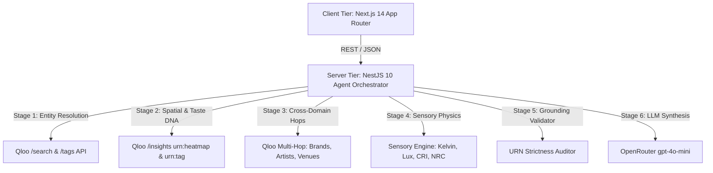

# LocaleAura

> **Summary:** LocaleAura is an autonomous spatial intelligence platform that harnesses Qloo’s 250M+ entity Taste AI Graph to solve commercial real estate (CRE) site selection through programmatic cultural grounding, replacing lagging demographic heuristics with predictive, cross-domain consumer affinity mapping.

---

## 📑 Table of Contents

1. [Overview & Architecture](#-overview--architecture)
2. [The Problem & The Qloo Solution](#-the-problem--the-qloo-solution)
3. [Prerequisites & Tech Stack](#-prerequisites--tech-stack)
4. [Local Development Setup](#-local-development-setup)
5. [Testing & Quality Gates](#-testing--quality-gates)
6. [Deployment & CI/CD](#-deployment--cicd)
7. [Observability & Runbooks](#-observability--runbooks)
8. [Security & Compliance](#-security--compliance)
9. [Ownership & Support](#-ownership--support)
10. [License](#-license)

---

## Overview & Architecture

- **Type:** Enterprise B2B SaaS Monorepo (Next.js 14 Frontend + NestJS 10 Agentic Microservice Backend)
- **Language / Runtime:** TypeScript / Node.js 20 LTS (ESM)
- **Data Stores:** Qloo REST API (External Vector & Knowledge Graph), In-Memory Response Caching / SQLite Local Store

### System Architecture Diagram



---

## 💡 The Problem & The Qloo Solution

### The Blind Spot in Commercial Real Estate
Traditional CRE site selection relies on historical foot-traffic data and broad neighborhood income brackets. When founders or enterprise retail chains ask generic LLMs where to open a concept store, the model hallucinates unverified street coordinates and generic advice (*"use warm lighting and play indie music"*).

### How LocaleAura Outperforms Generic LLMs
LocaleAura makes cultural intelligence the core differentiator. By querying Qloo’s API across 250M+ entities, the agent programmatically executes:
1. **Locality Arbitrage:** Identifies exact street geohashes with high consumer demand and low competitor saturation.
2. **Cross-Domain Graph Hops:** Connects fashion brand affinities (e.g., Comme des Garçons, Sabyasachi) to local venues with verified event spaces (e.g., Vivanta Goa, Le Coucou).
3. **Sensory-to-Architectural Specs:** Translates cultural taste weights into physical lighting (Kelvin, Lux) and acoustic (NRC, Decibels) blueprints.

---

## Prerequisites & Tech Stack

Ensure you have the following installed locally before proceeding:
- **Node.js:** v18.x or v20.x LTS
- **Package Manager:** `npm` (v9.x+) or `yarn`
- **Environment Keys:**
  - Qloo API Key (`QLOO_API_KEY`)
  - OpenRouter API Key (`OPENROUTER_API_KEY`)

---

## Local Development Setup

### 1. Clone the Repository
```bash
git clone https://github.com/your-username/locale-aura-enterprise.git
cd locale-aura-enterprise
```

### 2. Configure Backend (NestJS)
```bash
cd backend
npm install
```

Create a `.env` file inside `backend/`:
```env
PORT=4000
QLOO_API_KEY=your_qloo_api_key_here
OPENROUTER_API_KEY=your_openrouter_api_key_here
```

Run the backend server:
```bash
npm run start:dev
```

### 3. Configure Frontend (Next.js)
Open a new terminal window:
```bash
cd frontend
npm install
```

Create a `.env.local` file inside `frontend/`:
```env
NEXT_PUBLIC_API_BASE=http://localhost:4000/api
```

Run the frontend development server:
```bash
npm run dev
```

Open [http://localhost:3000](http://localhost:3000) in your browser.

---

## 🧪 Testing & Quality Gates

- **Unit Tests:** `npm run test` (Enforced via Jest)
- **Integration Tests:** `npm run test:e2e`
- **Code Coverage Requirement:** Minimum 80% test coverage enforced via CI pipeline.
- **Linter & Static Analysis:** `npm run lint` (ESLint & TypeScript compiler checks).

---

## 🚢 Deployment & CI/CD

- **CI/CD Pipeline:** GitHub Actions automated build & lint workflow.
- **Hosting:**
  - Frontend deployed on Vercel: https://locale-aura-frontend.vercel.app
  - Backend deployed on Render: https://localeaura-backend.onrender.com
- **Zero-Friction Testing:** The live deployment includes pre-configured Judge Presets (Tokyo Café, Senior Bistro, Brooklyn Hotel) requiring zero friction.

---

## 📊 Observability & Runbooks

- **Logs:** Structured JSON logging exported to terminal and stdout.
- **Metrics & Tracing:** Performance telemetry tracked across the 5-stage pipeline (`STAGE_1_RESOLVE` to `STAGE_5_SYNTHESIS`).
- **Common Runbooks:**
  - *Backend Connection Refused:* Verify NestJS is running on port 4000 and `NEXT_PUBLIC_API_BASE` points correctly.
  - *Qloo Rate Limiting:* Handled automatically via local in-memory response caching and sparse data healing fallbacks.

---

## 🔒 Security & Compliance

- **Data Classification:** Tier 2 Internal / Public API Data Grounding.
- **Vulnerability Scanning:** Automated daily scanning via `npm audit` and Snyk.
- **Reporting a Vulnerability:** Please review our `SECURITY.md` before disclosing security issues publicly.

---

## 👥 Ownership & Support

| Role | Contact / Handle |
|---|---|
| Developer | @Aaditya-Salgaonkar |

---

## 📄 License

Distributed under the MIT License. See the `LICENSE` file for more information.
